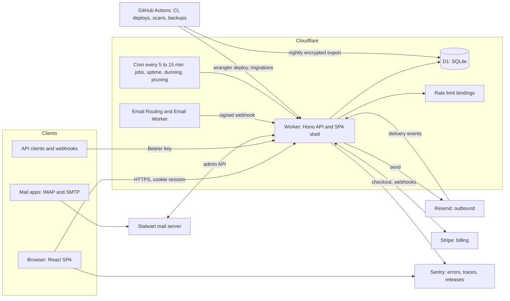

# MyMail

**Email for your team and your AI agents, on your own domain. Free for startups and small
businesses.** Add a domain, publish DNS records that check themselves live, create mailboxes for
people and inboxes for agents, and work the same threads in webmail, mail apps, the REST API or
MCP, with a person approving what agents send.

Live preview: **https://mymail.sites.tab.bot**. Staging: https://mymail-staging.mymail-app.workers.dev.
Tap *Try the live demo* for a private sample workspace, or sign up and add a real domain.

---

## What's in the box

| Area | What it does |
| --- | --- |
| **Accounts** | Better Auth: email and password (PBKDF2-SHA256), Google, GitHub and Auth0 SSO, TOTP two factor with backup codes, email verification, password reset, breached password check, lockout after repeated failures, per device sessions. |
| **Agent inboxes** | One API call creates an agent, its address and a scoped key. Threads as JSON (new text, one-time codes, links), send and reply with daily caps, allow lists and an approval queue, events by webhook, poll or SSE, a shared team inbox with agent replies labelled, and an audit trail. See `/agents` and [`docs/MCP.md`](docs/MCP.md). |
| **MCP** | `/api/v1/mcp` on the official SDK (Streamable HTTP, stateless), authenticated with scoped API keys: list inboxes, threads, search, send, reply, wait for mail, create agent inboxes, and the work tools (tasks, projects, docs, contacts). |
| **Tasks and projects** | One click makes a task from any thread (title from the subject, notes from the newest text, linked to the thread); replies on the thread show in the task's history. Assignee (a person or an agent), status, start and due dates, priority, labels, subtasks and comments. Projects with their own statuses (each in a to do, doing or done group), shown as a board (dnd-kit), a list (TanStack Table), a calendar (FullCalendar) or a timeline (SVAR Gantt), with saved filters. See [`docs/suite.md`](docs/suite.md). |
| **Docs** | Rich text docs (Tiptap) linked to projects, tasks, threads and contacts, with versioned saves; agents can search, read, create and append. |
| **Contacts and deals** | Contacts and companies built from mail as it arrives and is sent (robot senders and your own domains skipped, free mail domains get no company), backfilled once from existing mail, each with a timeline of threads, tasks and deals. A simple pipeline board in AUD. |
| **Automations** | Rules with no AI cost: mail from a sender or with a subject word makes a task, a status change notifies someone, a reminder before a task is due. Runs counted per month by plan. |
| **Push** | Device registration for the mobile app and Expo push for new mail, approvals and task events, behind `PUSH_ENABLED`. The payload carries only an event type and an id. |
| **AI assistant** | Bring your own AI: MyMail never pays for model calls. Summaries, drafted replies and sorting run only on the workspace's own OpenAI, Anthropic, OpenRouter or Groq key (Settings, encrypted at rest with APP_SECRET); without one, the app points people to connecting Claude, ChatGPT or any agent through the MCP server. No Workers AI binding and no metering. Invoice reminders come from a template and need no key. Xero (behind config) for unpaid invoices. |
| **Import** | Gmail, Outlook and IMAP import through a runner you host ([`deploy/import-runner`](deploy/import-runner/README.md)), behind `IMPORT_RUNNER_TOKEN`. |
| **Workspaces** | Isolated tenants with owner, admin and member roles, invitations, per mailbox access, SSO enforcement (Business), audit log with CSV export. |
| **Domains** | Per domain DKIM keys (encrypted at rest), generated MX, SPF, DKIM and DMARC records, live DNS verification over DNS over HTTPS with specific fixes. |
| **Mail** | Webmail with threads, search, drafts and attachments; IMAP and SMTP through Stalwart; inbound through Cloudflare Email Routing; outbound through Resend with retries, a circuit breaker and a non delivery report when a message finally fails. |
| **Developers** | REST API with OpenAPI 3.1 and a Scalar reference, API keys, Idempotency-Key support, Standard Webhooks with retries, dead letters, replay and auto disable. |
| **Billing** | Free forever (1 domain, 3 mailboxes, 3 GB, 3 agent inboxes, bring your own AI) plus A$1 to A$5 add-ons per business on one Stripe subscription, yearly when the total is under A$5 a month; proration, dunning with a 7 day grace period, usage alerts, legacy Pro and Business kept for existing customers. |
| **Privacy** | Self serve data export (JSON) and workspace export (ZIP with all mail), account deletion that never orphans a shared workspace, legal pages for Australian law (drafts for lawyer review). |
| **Abuse** | Outbound spam scoring, held messages, automatic suspension of new workspaces, per workspace send caps, operator console. |
| **Operations** | Strict CSP and security headers, rate limits on every scope, JSON logs with request ids, Sentry errors, tracing and releases, uptime history on `/status`, nightly encrypted backups, staging and production. |

## Architecture



Requests flow through one Hono app (`createApp(deps)`) on both runtimes: `src/entry/worker.ts` on
Cloudflare Workers with D1, and `src/entry/node.ts` on Node with SQLite. Everything outside the
process (database, DNS, mail provider, clock, fetch) is injected through `Deps`, which is also how
the tests swap in fakes. Slow or unreliable work goes through a durable job queue in D1
(`services/jobs.ts`) with leases, exponential backoff with jitter and dead letters; see
[`docs/architecture/queues.md`](docs/architecture/queues.md).

```
src/
  shared/          plans, schemas, legal documents shared by API and UI
  server/
    app.ts         middleware and routes
    auth.ts        Better Auth configuration and hooks
    emails/        React Email templates
    lib/           crypto, errors, logger, rate limits, idempotency, security headers
    routes/        HTTP handlers (thin, zod validated)
    services/      domains, mail, billing, privacy, abuse, jobs, status, webhooks
  entry/           node.ts, worker.ts
  web/             React 19 SPA (React Router, TanStack Query, Tailwind v4)
email-worker/      Cloudflare Email Worker for inbound mail
drizzle/           SQL migrations
tests/             Vitest unit and API integration tests
e2e/               Playwright end to end tests
load/              k6 load test
docs/              runbooks, security, legal, architecture
```

## Run it locally

Requires Node 22.

```bash
npm install
cp .env.example .env            # defaults work for local dev
npm run dev                     # API on :8787, web on http://localhost:5173
```

Set `DEMO_MODE=true` in `.env` for sample data.

### Checks

```bash
npm run typecheck      # tsc, strict
npm run lint           # eslint
npm run lint:copy      # no dashes or filler words in product copy
npm run test:coverage  # Vitest with coverage thresholds
npm run test:e2e       # Playwright (first: npx playwright install chromium)
npm run lhci           # Lighthouse budgets
k6 run load/smoke.js   # load test, see load/README.md
```

CI (`.github/workflows/ci.yml`) runs all of these, plus a dependency audit gate and Vale on the docs.
`security.yml` runs Semgrep and gitleaks, `zap.yml` runs a weekly OWASP ZAP baseline, Dependabot
keeps dependencies current, and `backup.yml` takes nightly encrypted database backups.

## Environments and deploys

| Environment | URL | Database | Deploys |
| --- | --- | --- | --- |
| Preview | https://mymail.sites.tab.bot | preview D1 | by hand, `publish_preview` |
| Staging | https://mymail-staging.mymail-app.workers.dev | `mymail-staging` | every push to `main` after checks pass |
| Production | https://mymail.mymail-app.workers.dev | `mymail` | the same build as staging, after staging smoke tests and the `production` environment gate |

Each deploy applies D1 migrations first, deploys with the commit as the Sentry release, runs
`scripts/smoke.sh`, and uploads source maps. See [`docs/runbooks/release.md`](docs/runbooks/release.md)
for the checklist and [`docs/runbooks/incident.md`](docs/runbooks/incident.md) when something breaks.
Restores: [`docs/runbooks/restore.md`](docs/runbooks/restore.md). Service levels: [`docs/slo.md`](docs/slo.md).

Repository secrets: `CLOUDFLARE_API_TOKEN`, `CLOUDFLARE_ACCOUNT_ID`, `SENTRY_AUTH_TOKEN`. App secrets
live in Cloudflare (`wrangler secret put`, listed at the top of `wrangler.toml`).

## More detail

**Developer platform**: API keys (Settings, Developers), a REST API at `/api/v1` whose OpenAPI 3.1
document (`/api/v1/openapi.json`) is generated from the request schemas by `@hono/zod-openapi`, an
interactive reference at `/api/v1/docs` (Scalar), and outbound webhooks (`message.received`,
`message.sent`, `message.bounced`, `message.complained`, `domain.verified`, `domain.failed`) signed
with the [Standard Webhooks](https://www.standardwebhooks.com) spec. Verify them with any Standard
Webhooks library and the endpoint's `whsec_` secret. Failed deliveries retry with backoff for about
nine hours, then wait as dead letters you can replay. An endpoint that fails five deliveries in a
row is switched off and its owners are emailed.

**Around the app**: a six-step setup checklist on the dashboard, a command palette (Cmd+K or Ctrl+K),
a public status page at `/status` backed by `GET /api/status`, and Australian defaults (en-AU
formatting, `Australia/Sydney` and AU per workspace, prices in AUD). `npm run design:audit` runs the
impeccable detector over every page and `npm run a11y:audit` runs axe-core (WCAG 2.2 AA); both take
a base URL, an output file and `--cookies` for signed-in pages.

**Deliverability**: Resend delivery events (`/api/webhooks/resend`, verified with the Standard
Webhooks library because Resend signs with Svix) mark bounces and complaints in the delivery log.
Hard bounces and complaints go on a per-workspace suppression list that sending skips. DMARC
aggregate reports (.xml, .xml.gz or .zip) are read from mail to any mailbox whose name or subject
mentions DMARC or a report, or uploaded by hand, and parsed with fast-xml-parser and fflate. Each
domain gets a 0 to 100 health score from its DNS records, DMARC policy, DMARC pass rate, bounce rate
and complaint rate. On the Node server, inbound mail is checked with mailauth (DKIM, DMARC, ARC);
the Workers build keeps the verdicts Cloudflare Email Routing writes. Set `RESEND_WEBHOOK_SECRET` to
the endpoint's signing secret from Resend.

**Mail apps (IMAP and SMTP)**: MyMail drives a Stalwart mail server for Outlook, Apple Mail and
phones. `docker compose up` runs both; see [`docs/mail-server.md`](docs/mail-server.md).

## Making real mail flow

1. **A domain** you control, added in MyMail.
2. **Inbound:** put the domain on Cloudflare (free), enable *Email Routing*, deploy `email-worker/`
   with a key from *Settings → Inbound*, and route the catch-all to the worker. Full steps in
   [`email-worker/README.md`](email-worker/README.md).
3. **Outbound:** create a Resend account, verify the domain there, and set `RESEND_API_KEY`.
   Until then, mail to outside addresses is saved to *Sent* and logged as *queued*.

## Environment variables

See [`.env.example`](.env.example) for every variable with comments. The important ones:

| Variable | Default | Notes |
| --- | --- | --- |
| `APP_MODE` | `development` | `production` requires `APP_SECRET` and sets Secure cookies |
| `APP_SECRET` | (none) | 32+ random chars; encrypts DKIM keys and webhook secrets |
| `APP_URL` | `http://localhost:5173` | Public URL, used in the inbound setup screen |
| `DATABASE_PATH` | `.data/mymail.db` | Node only; Workers use the `DB` D1 binding |
| `DEMO_MODE` | `false` | Enables sandbox demo workspaces |
| `DNS_RESOLVER` | `doh` | `doh` or `node` |
| `MAIL_MX_HOSTS` | Cloudflare Email Routing | `host:priority,…` |
| `MAIL_SPF_INCLUDES` | `_spf.mx.cloudflare.net` | comma separated |
| `MAIL_DKIM_SELECTOR` | `mymail` | |
| `OUTBOUND_DRIVER` | `log` (or `resend` when a key is set) | |
| `RESEND_API_KEY` | (none) | enables real external sending |
| `IMPORT_RUNNER_TOKEN` | (none) | turns on mail import; the runner uses the same token |
| `XERO_CLIENT_ID`, `XERO_CLIENT_SECRET` | (none) | turns on the Xero connection |
| `BODY_STORE_*` | (none) | S3 compatible bucket for attachments over 1 MB ([`deploy/au`](deploy/au/README.md)) |
| `AGENT_MAIL_DOMAIN` | (none) | shared domain for agent inboxes in workspaces without one |
| `PUSH_ENABLED` | (off) | `1` sends Expo push notifications to registered devices |
| `EXPO_ACCESS_TOKEN` | (none) | optional; only needed if the Expo project requires access tokens for push |

## Security

See [`SECURITY.md`](SECURITY.md) to report a vulnerability and [`docs/security.md`](docs/security.md)
for the controls: CSP and headers, rate limits, lockout, CSRF, input validation, secrets at rest,
untrusted HTML mail, dependency and code scanning. Secrets rotation: [`docs/security/secrets-rotation.md`](docs/security/secrets-rotation.md).

## Known gaps

- Production needs a custom domain; it runs on its workers.dev address today.
- R2 backups need a payment method on the Cloudflare account; nightly backups go to GitHub Actions artifacts until then.
- Legal pages are drafts for review by an Australian lawyer.
- Mail is not hosted in Australia yet: D1 is placed in Cloudflare's Oceania region by a hint. `deploy/au` is the groundwork for a Sydney VPS.
- ChatGPT and Claude Desktop custom connectors need OAuth, which MyMail doesn't offer yet; the docs use API key headers (Claude Code, Cursor, OpenAI API) and the mcp-remote bridge.
- A domain can belong to one workspace; claiming a squatted domain is manual.
