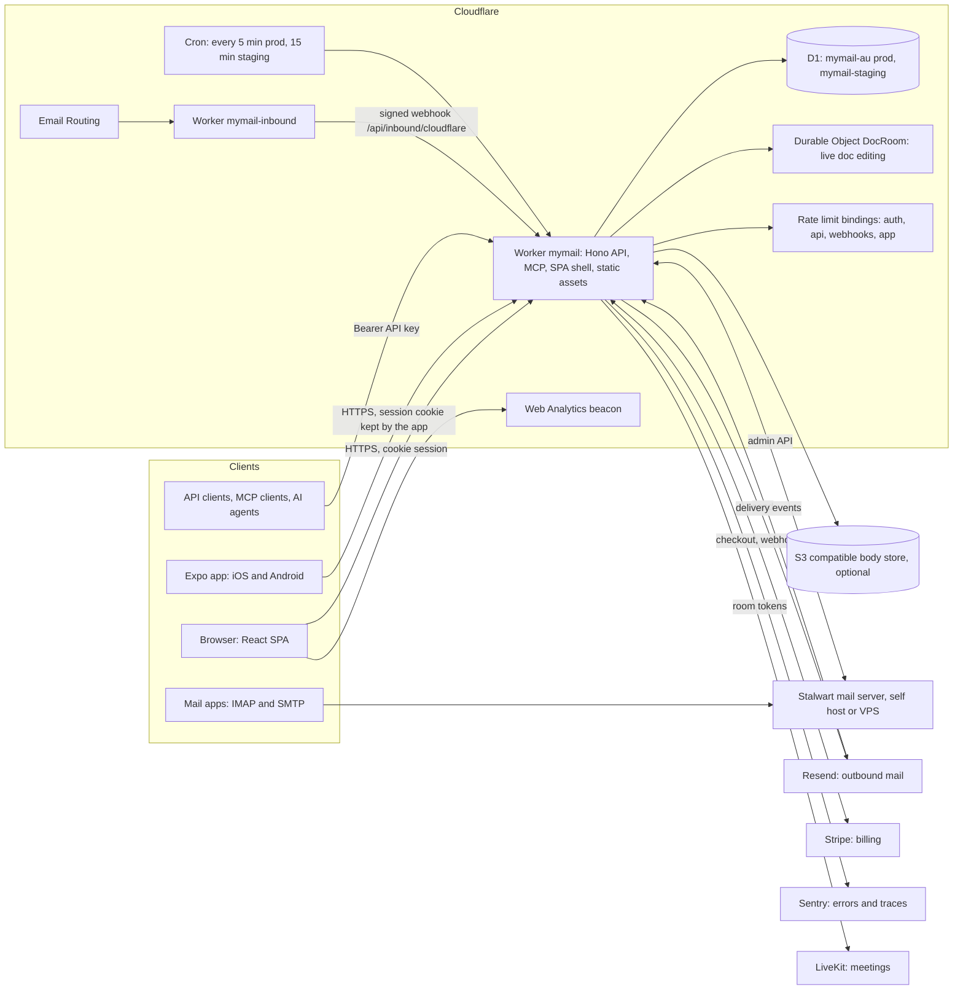

# Architecture

Multies is one TypeScript code base. A single Hono app, `createApp(deps)` in `src/server/app.ts`,
serves the REST API, the MCP server, webhooks and the React web app shell. It runs on two runtimes:

- **Cloudflare Workers** (`src/entry/worker.ts`) with D1, a Durable Object and rate limit bindings. This is production and staging.
- **Node** (`src/entry/node.ts`) with SQLite through better-sqlite3. This is local development, the Docker image and the self host stack.

Everything outside the process (database, DNS resolver, outbound mail, body store, clock, fetch) is
injected through `Deps`, which is also how the tests swap in fakes.



## Components

| Component | Where | Notes |
| --- | --- | --- |
| Worker `mymail` (prod) and `mymail-staging` | `wrangler.toml`, `src/entry/worker.ts` | Placed in `aws:ap-southeast-2` (Sydney) next to the database. Static assets from `dist/worker`; `/api/*` and `/.well-known/*` run the Worker first. The Worker writes each page's title, description, canonical and social tags into the HTML. |
| Lazy routers | `src/server/app.ts` | The public v1 API (about 150 OpenAPI routes) and the round 10 routers (chat, templates, goals, key results, guest chat) are built on their first request, not when an isolate starts. On the Workers Free plan a request gets 10 ms of CPU, and building them on start pushed the first request of each isolate over it (503 with an empty body). New heavy routers follow the same pattern. |
| D1 | binding `DB` | Production database `mymail-au` (Oceania), staging `mymail-staging`. Migrations in `drizzle/`, applied at deploy time with Wrangler, never on a request. The old US database `mymail` is kept until prod has run a week on `mymail-au`. |
| Durable Object `DocRoom` | binding `DOC_ROOMS`, `src/server/collab/` | One object per doc, SQLite storage, hibernating WebSockets, Yjs updates for live co-editing. |
| Rate limits | `RL_AUTH` 30/min, `RL_API` 600/min, `RL_WEBHOOKS` 600/min, `RL_APP` 300/min | Cloudflare rate limit bindings, with a D1 fallback (`api_rate_limits`) on Node. |
| Cron | `[triggers]` in `wrangler.toml` | Job queue, reminders, recurring work, uptime checks, dunning and pruning, each inside a per run budget. |
| Job queue | `src/server/services/jobs.ts` | Durable jobs in D1 with leases, backoff and dead letters. See [architecture/queues.md](architecture/queues.md). |
| Inbound mail | `email-worker/` (Worker `mymail-inbound`) | Cloudflare Email Routing hands each message to this Worker, which posts it to `/api/inbound/cloudflare` signed with an inbound key. The target URL is `MYMAIL_WEBHOOK_URL` in `email-worker/wrangler.toml`. |
| Outbound mail | `src/server/services/mail/outbound.ts` | Resend when `RESEND_API_KEY` is set, SMTP with the domain's DKIM key when `SMTP_HOST` is set (self host), otherwise logged (and written to `OUTBOX_DIR` on Node). |
| Body store | `src/server/services/storage/body-store.ts` | Optional S3 compatible bucket (`BODY_STORE_*`) for attachments over 1 MB. Cloudflare R2 works here through its S3 API; no R2 binding is configured today. |
| Analytics | `/api/config` returns `cfBeaconToken` | Cookieless Cloudflare Web Analytics; the CSP allows the beacon only when a token is set. |
| Errors and traces | Sentry | Releases tied to commits, hidden source maps, alerts by email to the support mailbox. |
| Web app | `src/web/` | React 19, Vite, React Router, TanStack Query, Tailwind v4, design tokens from `brand/tokens.json` (light and dark). |
| Mobile app | separate Expo project | See [mobile.md](mobile.md). |

## Self host and Node

`Dockerfile` builds the Node server (API and web app in one process). `docker-compose.selfhost.yml`
runs a whole install on one computer: `mymail` (the app), `stalwart` (IMAP and SMTP), `mail-bridge`
(hands mail from Stalwart to the app), `setup` and `tools`, with data volumes. Steps:
[self-host.md](self-host.md) and [mail-server.md](mail-server.md).

## Source layout

```
src/
  shared/          plans, schemas, known routes, legal documents shared by API and UI
  server/
    app.ts         middleware, routes, lazy routers
    auth.ts        Better Auth configuration
    collab/        Durable Object for live docs
    db/            Drizzle schema and migration runner
    emails/        React Email templates
    lib/           crypto, errors, logger, rate limits, idempotency, security headers
    routes/        HTTP handlers (thin, zod validated); v1-*.ts are the public API
    services/      domains, mail, suite, billing, agents, jobs, webhooks, status
  entry/           worker.ts, node.ts, smtp-outbound.ts
  web/             React SPA
email-worker/      inbound Email Worker
drizzle/           SQL migrations
tests/, e2e/       Vitest and Playwright
brand/             tokens and logo build
```
