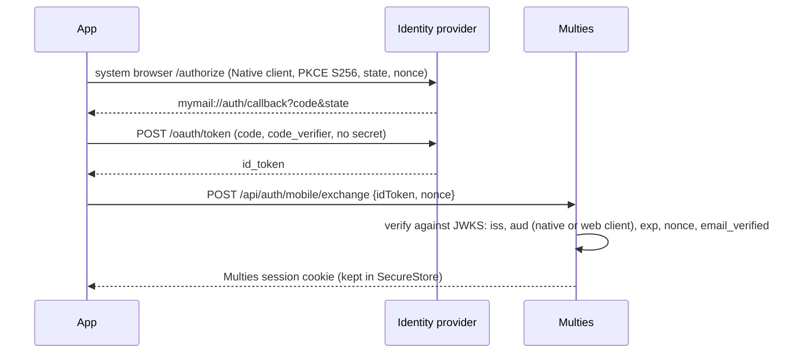

# Authentication

Multies has two kinds of callers, and each has one way in:

- **People** sign in through the identity provider (Auth0, OIDC). Its Universal Login is the one
  sign in and sign up page on the web and in the mobile app.
- **Agents and scripts** use personal API keys and MCP tokens. They never use the identity provider.

Better Auth owns the Multies session for people in both cases. Decision record: [ADR 0007](adr/0007-auth0-identity-provider.md).

## Code map

Everything lives in `src/server/auth/`:

| File | What it does |
| --- | --- |
| `options.ts` | Better Auth options: database, session, rate limits, hooks (lockout, audit log of security events), plugins |
| `config.ts` | `authMode()`: is the identity provider on, is the password form on, is mobile exchange on |
| `providers.ts` | The identity provider as an OIDC client (PKCE, discovery, ID token checks), direct social providers for self host, the provider logout URL |
| `session.ts` | Cookie attributes, session lifetime, login method, the in-memory rate limit store |
| `linking.ts` | Linking a provider sign in to an existing account by verified email |
| `tokens.ts` | ID token verification against the provider's JWKS (lazy loaded, cached per isolate) |
| `mobile.ts` | `POST /api/auth/mobile/exchange` and `GET /api/auth/logout/idp` |
| `guards.ts` | `requireAuth`, `requireAdmin`, `requirePlatformAdmin` used by every route that acts for a person |

API keys and MCP tokens: `src/server/services/developer/api-keys.ts`, checked in `routes/v1.ts` and `routes/mcp*.ts`.

## Web sign in

```mermaid
sequenceDiagram
  participant B as Browser
  participant M as Multies (Worker)
  participant I as Identity provider
  B->>M: POST /api/auth/sign-in/social {provider: auth0}
  M-->>B: authorize URL (state, nonce, code_challenge S256), state cookie
  B->>I: GET /authorize?... (Universal Login: password, code, passkey, social, MFA)
  I-->>B: 302 /api/auth/callback/auth0?code&state
  B->>M: GET /api/auth/callback/auth0
  M->>I: POST /oauth/token (code, code_verifier, client secret)
  I-->>M: id_token
  M->>M: verify signature (JWKS), iss, aud, exp, nonce; link or create user
  M-->>B: 302 /app + HttpOnly session cookie
```

- The callback path is `/api/auth/callback/auth0` on every host.
- "Create account" sends `screen_hint=signup`, so the provider opens its sign up screen.
- Sign out ends the Multies session (`POST /api/auth/sign-out`), then the browser goes to
  `/api/auth/logout/idp`, which redirects to the provider's `/v2/logout` with `returnTo=<APP_URL>/login`.

## Mobile sign in



The app keeps only the Multies session cookie, in the device's secure storage. Provider tokens are
dropped after the exchange.

## Existing accounts

On first sign in through the provider, Multies looks for an account with the same email:

- The provider must say the email is verified. No provider is trusted by name. The tenant's
  post login Action also refuses password accounts until they confirm their email.
- If the existing account's own email was confirmed, the provider account is linked and the person
  lands in the same workspace.
- If it was never confirmed, the provider has just proved who owns the address: the account is linked,
  marked verified, and its password and other sessions are removed, so whoever registered that address
  without owning it loses access.

## The password form (`AUTH_LOCAL_PASSWORD`)

| Deployment | Default | Password form, reset, verification |
| --- | --- | --- |
| Identity provider configured (cloud) | off | Handled by Universal Login |
| No identity provider (self host, Node, Stalwart) | on | The app's own forms and emails |

`AUTH_LOCAL_PASSWORD=on` keeps both side by side; `off` without an identity provider is ignored so a
deployment can never lock itself out. Local passwords are hashed with PBKDF2-SHA256 at 100,000
iterations, the most Cloudflare Workers allows in its WebCrypto; the stored format records the
parameters so they can be raised. That is acceptable because cloud accounts use the provider's
password storage once the form is off.

## Sessions, cookies and limits

- Session cookie: HttpOnly, Secure in production, SameSite=Lax, prefix `mymail`. 30 day lifetime,
  rolled forward once a day, revocable from Account and security. Sensitive changes need a sign in
  from the last 15 minutes.
- Auth rate limits are counted in memory per Worker isolate, with no database write per request. The
  account lockout and the provider's own brute force protection hold across isolates.
- Client addresses (rate limits, the audit log, Better Auth's limits and session IP) follow one rule
  (`clientIp` in src/server/middleware.ts). On Workers: `CF-Connecting-IP` only. On Node (self host):
  `CF-Connecting-IP`, `X-Real-IP` or `X-Forwarded-For` only with `TRUST_PROXY=true` (behind your own proxy),
  otherwise the connection's own address, so a client can't name its address.
- Workspaces can require single sign on; owners keep password access as the break glass account.

## Agents: API keys and MCP tokens

- Created per workspace in Developer settings, with a scope (read, write or admin) and optionally bound
  to one agent. The full key is shown once; only its hash is stored.
- Sent as `Authorization: Bearer <key>` to `/api/v1` and the MCP endpoint. A key never opens a browser
  session and a browser session never authorises `/api/v1`.

## Configuration

| Variable | Meaning |
| --- | --- |
| `AUTH0_DOMAIN` | Tenant domain, for example `dev-s8n2ciq6co7gzsec.us.auth0.com` (later `login.multies.si`) |
| `AUTH0_CLIENT_ID`, `AUTH0_CLIENT_SECRET` | The Regular Web Application "Multies" (secret: `wrangler secret put`) |
| `AUTH0_NATIVE_CLIENT_ID` | The Native application "Multies Mobile"; turns on `/api/auth/mobile/exchange` |
| `AUTH0_SOCIAL_CONNECTIONS` | Round 25: `google-oauth2,windowslive` shows "Continue with Google" and "Continue with Microsoft" on sign in and sign up (each starts the provider with that connection). Unset: no buttons. See docs/runbooks/social-login.md |
| `AUTH_LOCAL_PASSWORD` | `on` or `off`, see above |
| `TRUST_PROXY` | `true` to believe forwarded client addresses |
| `PASSWORD_BREACH_CHECK` | Breach check for local passwords (only while the password form is on) |

The mobile app reads `EXPO_PUBLIC_IDP_DOMAIN` and `EXPO_PUBLIC_IDP_CLIENT_ID`, with the tenant's values
as defaults. Credentials are listed by name in CREDENTIALS (owner email v7), sections "Auth0" and
"Auth0 round 11".

## The tenant (dev-s8n2ciq6co7gzsec, US, Free plan)

- Applications: "Multies" (Regular Web), "Multies Mobile" (Native, PKCE, rotating refresh tokens),
  "Multies Management (Tab)" (machine to machine, configuration only).
- Callbacks `/api/auth/callback/auth0`, logout URLs (origin and `/login`) and web origins for
  multies.si, app.multies.si, www.multies.si, both workers.dev hosts, preview.multies.si,
  localhost:5173 and localhost:8792. Mobile: `mymail://auth/callback`.
- Connections: Username-Password (minimum 12 characters with upper, lower and digit, no repeated or
  sequential characters, password history 5, dictionary and personal data checks, brute force
  protection), passkeys on the database connection, passwordless email codes, Google, Apple and GitHub
  on the provider's development keys. Microsoft is created but switched off until it has real keys.
- Attack protection: breached password detection (block and notify), brute force protection,
  suspicious IP throttling, bot detection.
- MFA factors available: authenticator app (OTP), email, security keys, recovery codes. The post login
  Action "Multies login policy" asks for a second factor from anyone who has enrolled one.
- Universal Login: new experience, identifier first, Multies name and A3 logo, accent #0071E3, dark text
  #1D1D1F on #F5F5F7, custom titles "Sign in to Multies" and "Create your Multies account".

## Owner steps

1. **Production social keys.** The provider's development keys show its own consent screens and are
   rate limited. Create OAuth apps in your own Google Cloud, Apple Developer and Microsoft Entra
   accounts, with the callback `https://<tenant domain>/login/callback`, and paste the keys into the
   Google, Apple and Microsoft connections (then switch Microsoft on for both applications).
2. **Custom login domain.** `login.multies.si` needs a verified card on the Auth0 account, even on Free.
   After adding it, add a CNAME in the multies.si zone and set `AUTH0_DOMAIN=login.multies.si`.
3. **Email from Auth0.** Auth0's built in email is for testing. Add an email provider in the tenant
   (Resend works over SMTP) so codes and verification mail come from no-reply@multies.si.
4. **After the trial.** Breached password detection and bot detection are trial features on Free. When
   the trial ends they switch off by themselves; brute force protection, passkeys, MFA and the rest stay.
5. **Turnstile** stays available for the password form on self host (an owner step for its keys).

## Tests

- Unit and integration (`tests/auth-idp.test.ts`): the password flag, the linking rule, ID token checks
  against a mocked JWKS, the authorize redirect with PKCE, state and nonce, the callback with a mocked
  token endpoint, a forged state, linking and takeover, the mobile exchange.
- E2E (`e2e/auth-idp.spec.ts`): a local server with the provider faked in process
  (`e2e/support/idp-server.ts`); the login button goes to the authorize URL and the callback lands
  signed in. Local only.
- Mobile (`__tests__/idp.test.ts`): PKCE values, state checks, the code exchange.
