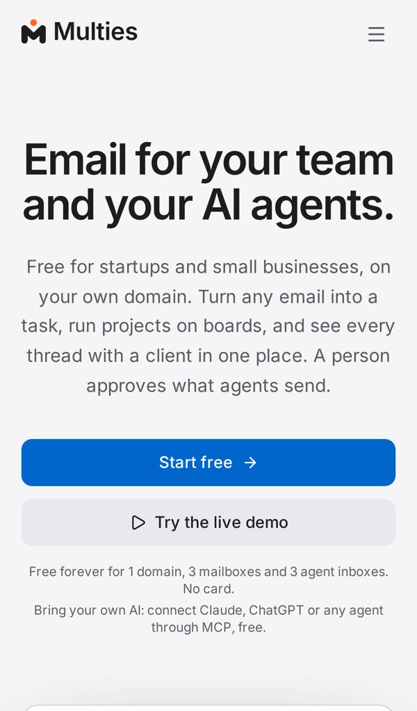
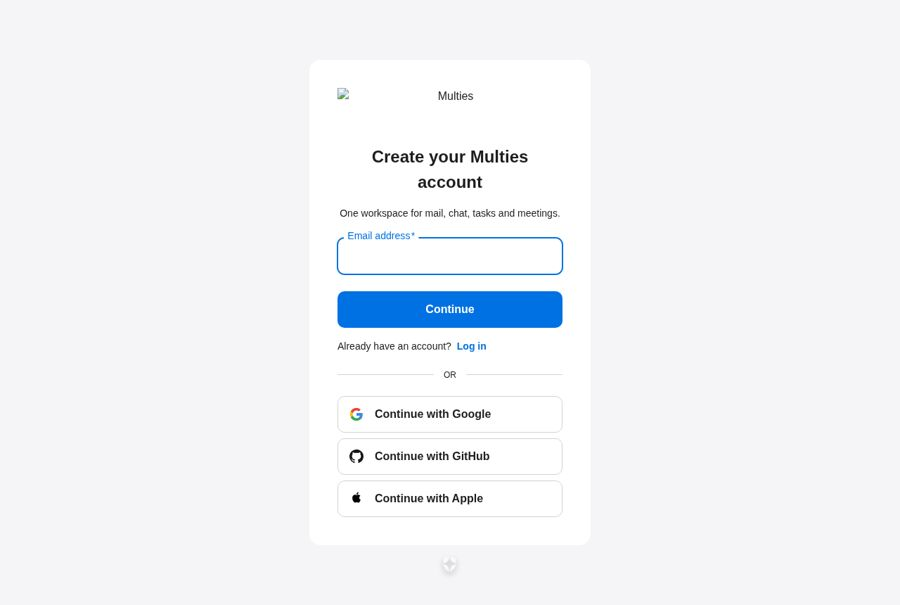
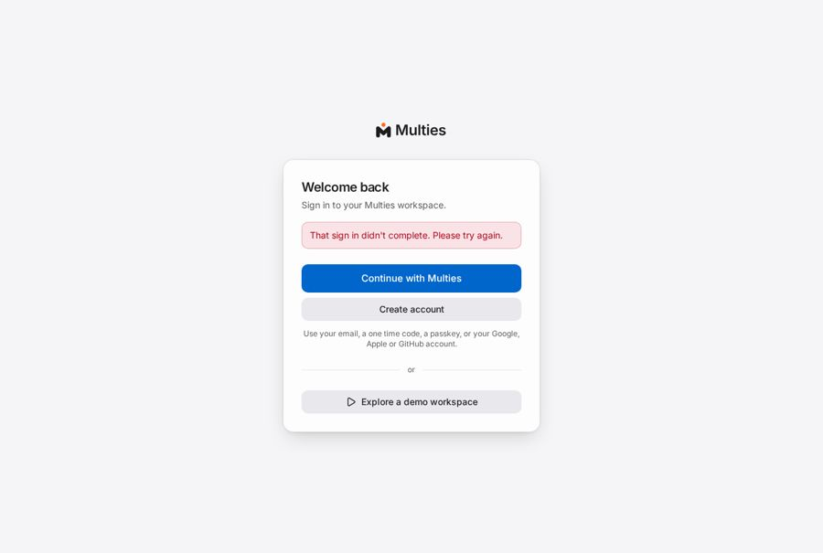
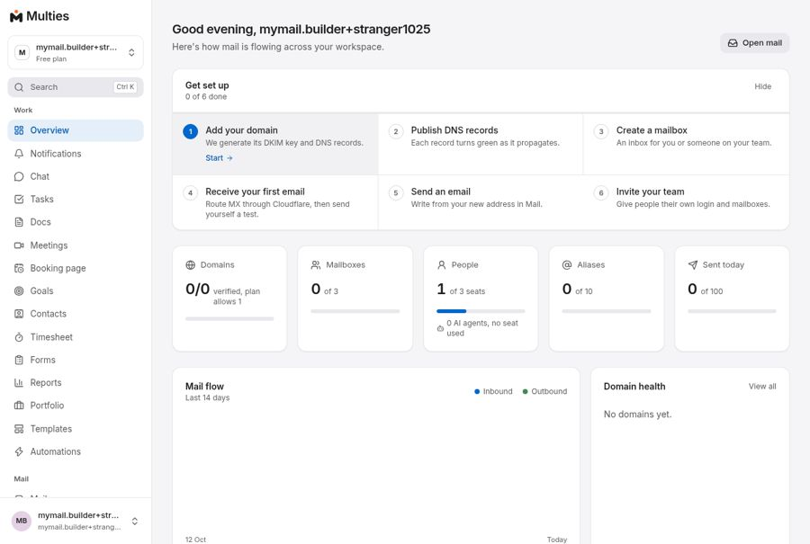
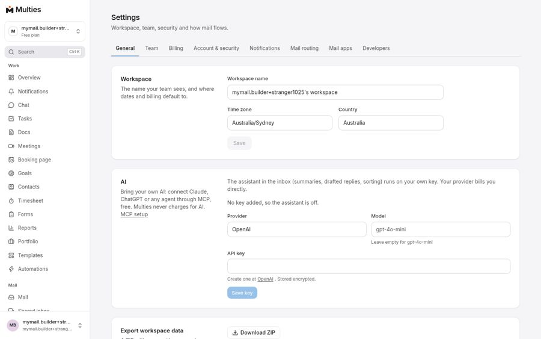
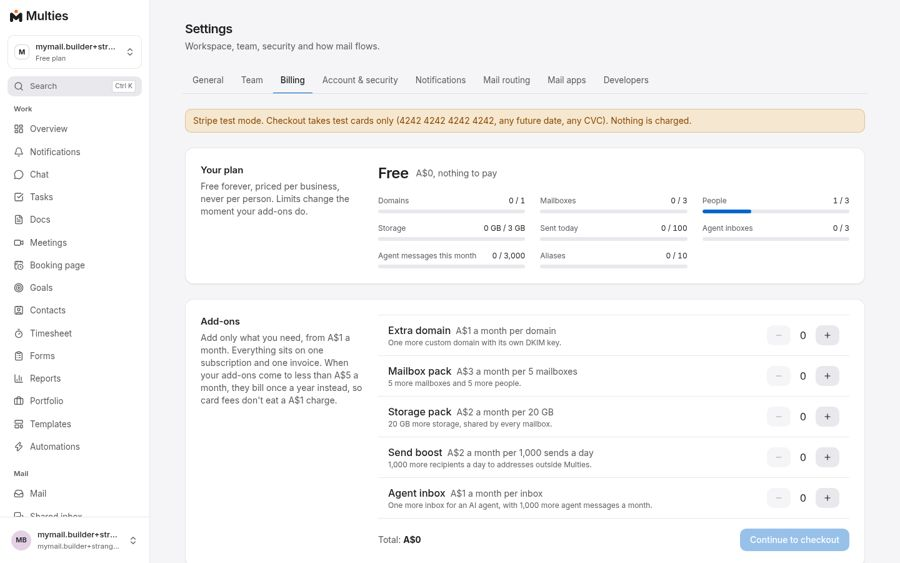
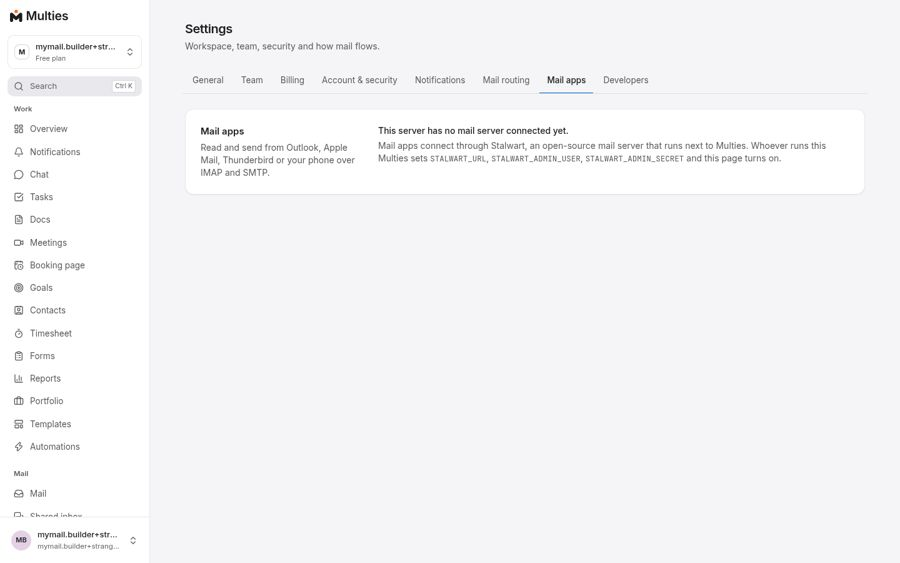
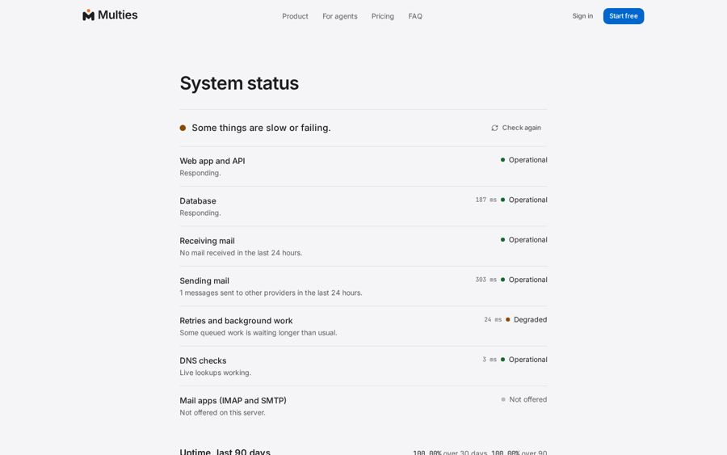
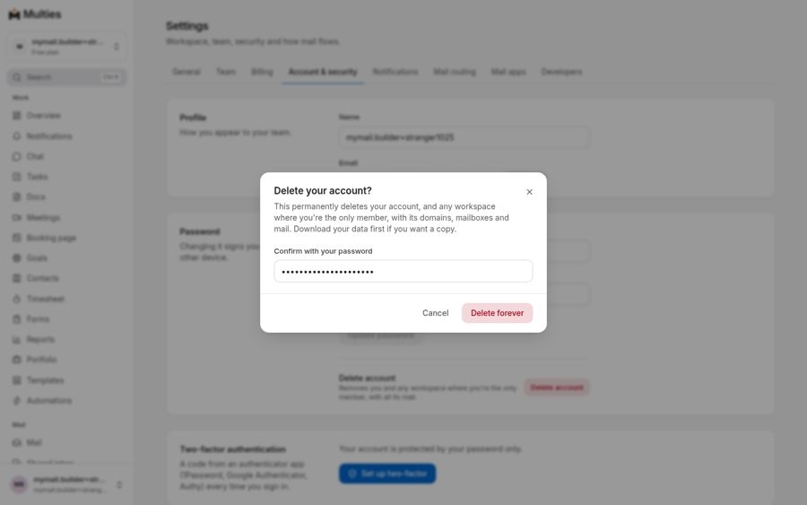

# Multies: product plan and gap audit

Internal document. It lives only in this private repo and is never published on a website.

25 October 2026. Written for Bidur, Fintex Australia Pty Ltd.

You asked for two things: make Multies work for anyone in the world, and plan the whole app properly, because today it is half done. This page does both. It starts with what a stranger actually sees, then scores every area, then lists what to build, in order, with a clear test for "done".

## How this was checked

On 25 October at about 7:45 PM Sydney time, I signed up as a stranger on the live site: a new email address, a French browser, the São Paulo time zone. I went from the home page to a verified account, an empty workspace, a chat message, and then deleted the account. Every screen was captured on desktop and on a phone size. The phone apps were read from their code (iOS TestFlight 1.8.1 build 12, Android internal 1.8.1). Production health was read once at 08:56 UTC. One test account was made and then deleted. No load or end to end tests were run against production.

## The short answer

Sign up is open to anyone. There is no invite gate and no Gmail requirement. Any email works, and Google, Apple and GitHub buttons are there. So the "Gmail only" worry is not a code rule.

But a stranger outside Australia hits real walls:

1. **No domain, no product.** Without a domain you already own, you cannot get a mailbox, send or receive mail. Most freelancers and tiny businesses in the world stop here.
2. **Only one more customer domain fits.** Custom domains are registered with our sending provider, whose free plan allows 3 domains. multies.si and haajir.xyz already use 2, so the second new customer to add a domain will fail.
3. **Deleting your account on the web is broken** for everyone who signs in through the new login (Auth0). The button fails silently. The separate delete page works.
4. **After sign up you land on an error.** The sign in page says "That sign in didn't complete" instead of "check your email".
5. **Everything assumes Sydney.** New workspaces start in Australia/Sydney, chat times and meeting times show Sydney time, the greeting said "Good evening" at 5:48 AM in São Paulo.
6. **English only, Australian dollars only.** No other language on web, app or login. Prices are A$ ex GST.
7. **Payments are not live.** Billing shows "Stripe test mode, use card 4242".
8. **Phone and desktop mail apps are sold but not offered.** Pricing lists IMAP and SMTP; production says "Not offered on this server".
9. **Verification email comes from Auth0's shared test sender** (no-reply@auth0user.net with tracked links). Auth0 says that sender is for testing only.
10. **The database write cap can lock the app.** The whole Cloudflare account gets 100,000 writes a day. One workspace setup today used about 13,000. On 24 October the cap was hit and sign in went read only.

## What a stranger sees, step by step

### 1. Landing page
Clear, fast, works on a phone. Free plan is obvious. Weak spots: English only, prices in A$, and "Try the live demo" goes to a sandbox that never sends real mail, which is fine but not explained.

### 2. Create account
The sign up page is Auth0's hosted page on the raw address dev-s8n2ciq6co7gzsec.us.auth0.com, with a broken logo at the time of the test (a separate fix tonight sets the logo and removes the consent screen). It ignored the French browser. Copy says "Use your work email", which puts off people with a personal address.

### 3. Right after sign up
You are sent back to the Multies sign in page with "That sign in didn't complete. Please try again." The real reason ("Please confirm your email first. We sent you...") is hidden in the address bar. A stranger will think it is broken.

### 4. Verify email
The email arrived in under a minute, from "Multies" at no-reply@auth0user.net, plain, with a click tracking link. It works, but it is Auth0's shared test sender and will hit limits and spam folders at scale.

### 5. First sign in and empty workspace
Sign in worked once the email was verified. A bot check appeared on one retry. The workspace is named "qa.tester+stranger1025's workspace" and the greeting uses the email as a name, because nothing asks for a name or company. Step 4 of the checklist says "Route MX through Cloudflare", which means nothing to most people and is wrong for new domains (they route through our provider now). "0/0 verified, plan allows 1" is confusing.

### 6. Settings: time zone and country
New workspaces start in Australia/Sydney. The time zone list puts Australia first. Countries offered: 34. Your browser's own time zone is not used.

### 7. Mail, domains, mailboxes
Mail, Shared inbox and Mailboxes all say "No mailboxes yet" until a domain is added and verified. There is no free address on a Multies domain and no way to bring an existing Gmail or Outlook inbox without moving the domain. Add domain asks for "a domain you control".

### 8. Tasks, docs, chat, meetings, booking
These open and look finished. Chat worked: the message showed instantly, but stamped 7:52 pm (Sydney) for a user in São Paulo. The meeting dialog says "Starts (Australia/Sydney)". Meetings run in the browser; there are no recordings or transcripts.

### 9. Agents
The agent inbox pages are clear and are the strongest part of the product story. They also depend on a verified domain for real mail.

### 10. Billing
Shows "Stripe test mode. Checkout takes test cards only (4242...). Nothing is charged." to real customers. Prices in A$ only.

### 11. Mail apps (IMAP and SMTP)
The page shows server setup text meant for us ("Whoever runs this Multies sets STALWART_URL..."). Pricing promises Outlook, Apple Mail and phone access. Production does not have it.

### 12. Status page
Public status said "Some things are slow or failing", with background work "Degraded", and "Mail apps: Not offered on this server".

### 13. Delete account
Settings, Account, Delete account asks for a password that Auth0 users do not have in Multies. Pressing "Delete forever" fails (server answer: "Credential account not found") and nothing is shown. The public page multies.si/delete-account (type DELETE, leave password empty) worked and removed the account and its workspace. The Auth0 login itself is not removed by either path (no call to Auth0 in the code), so the person's identity record stays with Auth0.

### 14. Other things a stranger can see that they should not
- "Admin" is in everyone's sidebar and opens "Only platform operators can do that."
- Forms says "Add Cloudflare Turnstile keys to the server".
- Settings has its own password and two factor setup, separate from the Auth0 login, which is confusing for anyone who signed in with Google or Apple.
- Legal pages say "Draft for review by an Australian lawyer before launch."

## Phone apps (from code, 1.8.1)

**Can do:** sign in through Auth0, shared inbox, read threads, compose with undo send, search, approvals for agent mail, tasks (list, new, detail), chat (channels, threads, new chat), people, notifications with push, meetings (opens the call in the browser), portfolio, two factor, delete account (uses the working server path), offline queue for some actions. Store data safety and privacy answers are filled.

**Cannot do:** add a domain, create mailboxes, docs, calendar view, contacts, booking pages, goals, forms, billing, agent setup, workspace settings, or create a workspace. A new user who downloads the app first gets an empty inbox with nothing to do in the app. English only. The consent screen and broken logo on first sign in are being fixed tonight.

**Store state:** iOS 1.8.1 (12) on TestFlight, App Store availability set to 175 countries, not yet submitted for review. Android 1.8.1 on internal testing, store listing and declarations done, rating IARC 12+, review submission in progress tonight. Going public on Play needs a closed test with 12 testers opted in for 14 days.

## Scorecard

| Area | State | Notes |
|---|---|---|
| Sign up and sign in | Works | Open to anyone. Raw Auth0 address, English only, test email sender, confusing error after sign up |
| Onboarding | Partial | No name, company, country or time zone step. Checklist has wrong MX step |
| Domains and DNS | Partial | Good checks and records. Capped at 1 more customer by the provider's free plan |
| Mailboxes, send, receive | Partial | Needs your own domain. 100 sends a day on Free. Inbound on new domains depends on the provider webhook |
| Free address without a domain | Missing | The biggest gap for a global audience |
| Import from Gmail or Outlook | Partial | Exists (IMAP import). Not tested here |
| IMAP and SMTP for mail apps | Missing in production | Sold on pricing page |
| Shared inbox and approvals | Works | Strong for agents |
| Tasks, boards, timeline | Works | The monday and ClickUp side is broad |
| Docs | Works | Web only |
| Chat | Works | Times shown in workspace zone, not yours |
| Calendar, meetings, booking | Partial | Browser calls, no recordings or transcripts, Sydney defaults |
| Agents, API, MCP | Works | Best part of the story |
| Billing | Missing in production | Stripe in test mode. A$ only. No tax for other countries |
| Settings and account | Partial | Web delete broken for Auth0 users. Duplicate password and two factor |
| Phone apps | Partial | Good for inbox, chat, tasks. Cannot set anything up |
| Languages | Missing | English only everywhere |
| Time zones | Partial | Stored per workspace, defaults to Sydney |
| Currencies | Partial | A$ with clear label. No USD, EUR, GBP, INR prices |
| Privacy and legal | Partial | Pages exist and name Fintex. Marked draft, need lawyer review |
| Accessibility | Partial | Skip link, labelled fields. No full WCAG 2.2 AA audit on record |
| Reliability | Partial | Health checks and status page exist. Write cap, failing CI, failing backups |
| Security | Partial | Security review done in round 11. Turnstile not configured, admin link visible |
| Support | Partial | One email address, Sydney hours. No in app help |

## Roadmap

Each item has a test that says when it is done.

### Horizon 1: this week, to public launch

**Owner decision, 25 October 2026, 9:29 to 9:32 PM Sydney.** Customers never get an address on multies.si: the root domain is the company's own, for staff addresses (support@, hello@, security@ and the rest). The email model is three paths, offered in onboarding:
- A. Connect an existing mailbox from any provider (Gmail, Outlook or Microsoft 365, Yahoo, iCloud, Zoho, or any IMAP and SMTP server), with OAuth where the provider offers it and an app password otherwise: sync, send as that address, the person's real address.
- A. Or bring their own custom domain, with guided DNS setup (live since round 13).
- B. Or take a free personal address name@mail.multies.si (a subdomain, never the root).
- With none of these, tasks, chat and meetings work straight away, with a clear "Connect your email" step.

**1. Free personal addresses on mail.multies.si.** Anyone can take name@mail.multies.si, with send and receive, reserved names, sign up abuse limits (per person, network, device and day), smaller send limits for new accounts and spam checks before sending.
Done when: a stranger with no domain signs up and sends and receives a real email within 2 minutes, on web and phone.
Status 25 Oct (round 17): live on web, release 98879473fe4e. Live checked with one real send and receive, then the test address was deleted. Phone apps not checked. docs/runbooks/free-addresses.md.

**1b. Connect an existing mailbox (path A).** IMAP and SMTP with an app password first (any provider; Workers can open TLS sockets), then OAuth for Gmail and Microsoft 365. Two way sync, send as that address with its own SMTP or API so SPF and DKIM pass as the person's own domain.
Done when: a Yahoo and an iCloud account sync both ways and a reply sent from Multies arrives as the person's real address. Gmail OAuth needs Google's restricted scope review (owner, weeks); Microsoft needs a verified publisher.
Status 25 Oct: not started. Onboarding shows it as "Coming soon"; the old IMAP import is not switched on in production either.

**2. Lift the domain ceiling.** Move customer domains to a sending plan that allows many domains (the provider sells 100 more domains as an add on on paid plans), or send through a provider without a per domain cap.
Done when: 10 test domains can be added in staging without an error, and the limit is shown on the status page.
Status 25 Oct (round 17): the free way is live. A full plan queues a domain ("In the queue for a sending slot") instead of failing, it still receives mail, and the oldest queued domain takes the next free slot by itself. mail.multies.si took the last of the 3 free slots, so new customer domains queue until the sending plan is raised (owner, card). docs/runbooks/domain-cap.md.

**3. Fix account deletion.** Settings delete uses the same server path as the delete page, needs no password for Auth0 users, shows errors, and also deletes the person in Auth0.
Done when: an Auth0 user deletes from Settings on web, iOS and Android, and the Auth0 user is gone (Management API read returns 404).

**4. Fix the after sign up screen.** Show "Check your inbox at you@example.com" with a resend button instead of the error.
Done when: a new sign up never sees the word "didn't complete".

**5. Short onboarding.** Ask name, company, country and time zone (prefilled from the browser), then offer: free address, add your domain, or import Gmail or Outlook.
Done when: a workspace made from São Paulo shows America/Sao_Paulo times everywhere, and the greeting uses the person's name.
Status 25 Oct (round 17): live, release da06358e302d. Name, company, country (all 249), time zone and language from the browser; per person zone everywhere; then the three email paths. Local E2E signs up from São Paulo. Translations are horizon 2 (item 11).

**6. Branded login and email.** login.multies.si custom domain on Auth0, Multies logo, and Auth0 emails sent through our own sender as no-reply@multies.si without click tracking.
Done when: the sign up page address bar shows multies.si and the verify email passes SPF, DKIM and DMARC as multies.si.

**7. Stop selling what is not live.** Hide IMAP and SMTP from pricing and status until it works; remove operator text (STALWART_URL, Turnstile keys) and the Admin link for non operators.
Done when: no customer facing page names a server setting.
Status 25 Oct (round 17): live, release 659981b7aef2. Legal terms still mention IMAP and SMTP access (owner to approve a terms change).

**8. Payments live, or no checkout.** Either switch Stripe to live mode (owner identity and bank details needed), or hide add ons and say "Free during launch".
Done when: no real customer ever sees a test card number.
Status 25 Oct (round 17): the test mode banner and card number show to platform admins only; customers see "Paid add-ons aren't on sale yet". Live mode needs the owner's Stripe identity and bank details.

**9. Raise the write ceiling.** Move Cloudflare to the paid Workers plan (about US$5 a month, unverified, check the Cloudflare pricing page), keep the write guard, and cut setup writes.
Done when: the account cap is far above daily use and one workspace setup writes under 1,500 rows.

**10. Backups and CI green.** Fix the failing CI on main and the nightly backup (2 runs ever, the last failed on 24 October), or move backups to a Cloudflare cron so they do not depend on GitHub minutes.
Done when: 7 nightly backups in a row succeed and one restore to staging is tested.
Status 25 Oct (round 17): CI jobs never start because the GitHub account's payment failed or its spending limit is reached (owner, GitHub billing). The suite is green locally (446 unit, 59 E2E). The org setup script now estimates its writes in a dry run and stops at --max-writes.

### Horizon 2: next 30 days

**11. Languages.** Add a translation layer on web, phone and login. Start with Spanish, Portuguese, French, German, Hindi, Indonesian, Japanese and Nepali. Turn on the same languages in Auth0.
Done when: a browser set to French gets the full product in French, with no English strings on the main paths.

**12. Local prices and tax.** Prices in USD, EUR, GBP, INR and AUD, and Stripe Tax for GST, VAT and sales tax.
Done when: a buyer in Germany sees euros and VAT on the invoice.

**13. Bring your own mailbox.** Connect an existing Gmail or Outlook inbox (OAuth) so people can try tasks, chat and agents on their real mail before moving a domain.
Done when: a Gmail user sees their inbox in Multies within 5 minutes without touching DNS.

**14. Phone app setup.** Add domain, mailboxes, invite people and workspace settings in the app.
Done when: someone who only has a phone can set up a working team.

**15. Privacy for the world.** Lawyer review of privacy, terms and DPA; full sub processor list (LiveKit and Google Public DNS were missing on 24 October); data transfer terms for EU and UK customers; a data request log under the Australian Privacy Act; cookie notice for EU visitors.
Done when: "Draft" is gone from every legal page.

**16. Deliverability per region.** Warm up sending, set DMARC to quarantine on multies.si, add a bounce and complaint dashboard, test inbox placement at Gmail, Outlook, Yahoo, Yandex, QQ and Naver.
Done when: test mail lands in the inbox at all six.

**17. Accessibility.** WCAG 2.2 AA audit with axe on every main page and VoiceOver and TalkBack passes on the phone apps.
Done when: zero serious axe findings and a recorded screen reader run.

**18. Store launch.** App Store review submission with the review account; Play closed test with 12 testers for 14 days, then production.
Done when: both apps are public in all countries.

**19. Monitoring.** Alerts on sign in failures, mail delivery failures, write budget at 60% and queue delays, sent to the owner and to me.
Done when: a test alert reaches both within 5 minutes.

### Horizon 3: 90 days

**20. IMAP and SMTP for real.** Run a mail server (Stalwart) next to Multies so Outlook and Apple Mail work. Then put it back on the pricing page.

**21. Calls and meetings that compete.** Recordings, transcripts and notes that turn into tasks, phone dial in, and calendar sync with Google and Outlook.

**22. Data region choice.** Keep data in Australia, or choose Europe or the US at sign up.

**23. Agent marketplace.** Ready made agents (support triage, invoice reader, meeting notes) that any workspace can switch on with its own AI key.

**24. Migration tools.** One click move from Google Workspace, Microsoft 365, Zoho, monday and ClickUp, including tasks and boards.

**25. Trust.** SOC 2 readiness, a public security page with pen test results, and uptime history on the status page.

## Pricing

Keep Free forever for 1 domain, 3 mailboxes and 3 people. The add ons (A$1 to A$3 a month) are fair and simple. Two changes:

- Show prices in the visitor's currency, rounded to clean numbers (for example US$1, EUR1, INR 79).
- Add one bundle, "Team", for growing companies (for example 5 domains, 25 mailboxes, more storage) at one price, so a buyer does not have to add five add ons.

Keep phone app billing out of the apps for now, so Apple and Google in app purchase rules do not apply.

## Reliability and security

- **Write cap:** today 34,501 of 100,000 writes were used by 08:56 UTC. The paid plan fixes the ceiling; the code fix is to cut the cost of workspace setup and background jobs.
- **Backups:** the GitHub backup has failed. Use a Cloudflare cron export to storage we own, encrypted, kept 30 days.
- **CI:** CI on main is failing (the latest run on 25 October failed) and deploys have been done by hand. Nothing should deploy by hand while CI is red.
- **Bot protection:** turn on Turnstile for sign up and public forms.
- **Secrets:** rotate any key that was ever shared in chat or files; keep the credentials list offline.
- **Auth:** one login (Auth0) for people. Remove the separate Multies password and two factor screens once every account is on Auth0, and offer passkeys.

## First 100 real users

**Who:** two person to twenty person startups and agencies that already pay for Google Workspace or Microsoft 365 per seat and run tasks in another tool, plus solo developers building AI agents that need real inboxes.

**Customer zero:** Haajir. Run it fully on Multies (mail, tasks, chat, meetings) and publish what worked and what broke.

**Where to find them, free:**
- The 12 Play testers become the first circle. Ask each to bring one business.
- Indie Hackers, r/startups, r/smallbusiness, r/SaaS, r/selfhosted: one honest "we built this" post each, a week apart.
- Hacker News "Show HN" for the agent inbox API and MCP server, aimed at developers.
- Product Hunt launch once the free address and payments are live.
- AI agent communities (MCP directories, agent framework Discords): list the MCP server and the agent inbox quickstart.
- Australian startup groups (Fishburners, Startmate community, local Slack groups) for the home market.
- Nepal startup community, through your own network, as the second home market.
- The free domain checker (multies.si/check) as a search magnet: "who hosts my email" and "fix my SPF" pages.

**What we measure every week:**
- Sign ups, and how many reach "sent and received a real email" within one day.
- Teams with 2 or more active people after 7 days.
- Workspaces still active after 30 days.
- Agent inboxes created and API calls.
- Support emails per 100 users, and the top three reasons.

**Goal:** 100 workspaces that sent real mail, 30 still active after 30 days.

## What needs you

These need the owner, by law, by contract or by payment:

1. **Payments:** Stripe live mode needs your identity, Fintex bank account and business details.
2. **Plans that cost money:** Cloudflare paid Workers plan (about US$5 a month, unverified) and a sending plan with more domains. Both need a card.
3. **Legal review:** an Australian lawyer to sign off privacy, terms and DPA.
4. **Apple:** move the Apple developer account to the Fintex organisation (needs a D-U-N-S number) so the seller name reads Fintex, not your personal name.
5. **Play testers:** 12 Gmail addresses of real people for 14 days.
6. **DNS:** one record for login.multies.si once the Auth0 custom domain is set (I can do it if the Cloudflare token allows).
7. **Translations:** a native speaker to check Nepali and Hindi before release.

## The five things to build first

1. Free address on a Multies domain, so anyone can start without owning a domain.
2. Lift the 3 domain ceiling at the sending provider.
3. Fix account deletion (web Settings, and remove the Auth0 user).
4. Onboarding with name, country and time zone, and a clear "check your email" step.
5. Branded login and emails on multies.si, plus hide everything not live (test billing, IMAP, operator text).
